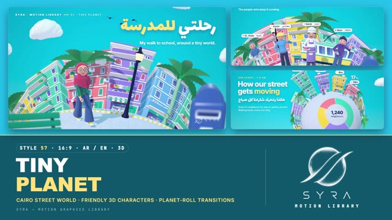

# 57 · Tiny Planet

**SYRA Motion Library** · Style 57 · 16:9 · Arabic / English



<div dir="rtl">

> طريقة الاستخدام:
> انسخ البرومت ده كله وحطه لأي أداة AI أو لسكيل الـ animate، واملا الجزء الأخير ([VIDEO BRIEF]) بموضوع الفيديو.
> الستايل ده "الكوكب الصغير" — 3D حقيقي (WebGL / three.js): حي مصري ملوّن ملفوف حوالين كوكب صغير، عمارات بتميل على الشارع المنحني، عدسة عين السمكة بتقوّس الأفق، وشخصيات لطيفة بعيون كبيرة وابتسامة دافية لابسين تريكو وجينز وجوخ. الانتقال بين المشاهد: الكوكب بيلف والحي اللي بعده بيطلع من ورا الأفق.
> مناسب للتعليم، الأطفال، قصص الحي والمجتمع، الصحة والرياضة، الأكل والمشاريع الصغيرة، المدينة والنيل، والبيانات البسيطة.
> المرجع الأساسي للشكل والحركة هو ملف "source/index.html". بيشتغل بالعربي وبالإنجليزي. ممنوع اللون البني والبيج.

</div>

## Files in this folder

| File | What it is |
|---|---|
| [source/index.html](source/index.html) | The motion itself — opens and plays in a browser; the source of truth |
| [sample.mp4](sample.mp4) | Showcase reel of the style |
| The info card at the top of this file | Tags & hashtags: what the style expresses, what it suits, search words |

## Tags

<div dir="auto">

النوع: 3D حقيقي (WebGL / three.js — كرتون أفلام أنيميشن، عدسة عين السمكة)  
في سطر: حي مصري ملوّن ملفوف حوالين كوكب صغير، عمارات بتميل على شارع منحني تحت سما سماوي وسحاب منفوخ، وشخصيات لطيفة بعيون كبيرة عايشة على الكوكب — مبهج وجيرة حلوة.  
In one line: A colourful Egyptian neighbourhood wrapped round a little planet in animated-film 3D — pastel Cairo blocks leaning off a curved street under a cyan sky, fisheye lens, blurred near-lens props and friendly big-eyed characters living on the curve.  
#عربي: #الكوكب_الصغير #3D #كرتون_3D #حي_مصري #شارعنا #جيرة #مجتمع #أطفال #تعليم #صحة #رياضة #مشاريع_صغيرة #المدينة #النيل #بيانات #إنفوجرافيك #مبهج #عيلة #بيئة  
#English: #tinyplanet #3d #3dcartoon #animatedfilm #fisheye #neighbourhood #cairo #egypt #community #kids #education #health #sport #smallbusiness #citylife #nile #data #infographic #cheerful #family  
مناسب لـ: قصص الحي والمجتمع والجيرة، تعليم أطفال ومدارس، توعية صحة ورياضة وبيئة وإعادة تدوير، مشاريع صغيرة ومحلات وتطبيقات توصيل، تقارير بيانات بسيطة ودودة (مباني بارات، دونات، خط بياني)، تعريف بفريق أو مهن (دكتورة، مهندس، شيف، مطوّرة)، خرايط مصر والنيل، تايتلات فصول ولوار ثيرد  
Best for: neighbourhood and community stories, kids and school education, health / sport / environment / recycling awareness, small businesses, shops and delivery apps, friendly simple data (bar buildings, ring chart, line ribbon), team or professions intros (doctor, engineer, chef, developer), Egypt and Nile maps, chapter cards and lower thirds  
مش مناسب لـ: شركات رسمية جادة أو بنوك، تقنية فيوتشرستك وداكنة، أخبار حزينة أو حساسة، فخامة ولوكس (استخدم Liquid Chrome)  
Not for: serious corporate or banking, dark futuristic tech, sad or sensitive news, luxury (use Liquid Chrome instead)  
المزاج: مبهج، دافي، ودود، متفائل، حيوي        Mood: cheerful, warm, neighbourly, optimistic, lively  
الإيقاع: متوسط        Pace: medium  

</div>

## Components

| # | Component |
|---|---|
| 01 | Title Walk To School |
| 02 | Data Bars Ring Globe |
| 03 | Data Line Chart Arabic |
| 04 | Product Phone App |
| 05 | Story Juice Stand |
| 06 | Team Street Heroes |
| 07 | Football First Goal |
| 08 | Mentor Nile Fishing |
| 09 | Three Steps Recycle |
| 10 | Big Number Steps |
| 11 | Timeline Year By Year |
| 12 | Quote Night Neighbours |
| 13 | Before After Roofs |
| 14 | Map Egypt Nile |
| 15 | Chapter Lower Third |
| 16 | End Logo Planet |
---

## TINY PLANET — MOTION GRAPHICS STYLE PROMPT (SYRA Motion Library · Style 57 · 16:9 · Arabic / English)

### Role

You are a senior motion designer producing motion graphics in the "Tiny Planet" style of the SYRA Motion Library, on ANY topic, in Arabic OR English (or both). Match the reference exactly: the source of truth is "source/index.html" (all components, playable in a browser).

### 1. Style identity

- One line: a whole Egyptian neighbourhood wrapped round a little planet, rendered as animated-film 3D — pastel Cairo apartment blocks with white trims, shutters, mashrabiya bays, balconies, laundry and water tanks lean out from a curved street under a bold cyan sky with chunky clouds; a fisheye lens bends the horizon, near-lens props blur, and friendly stylised people in knit, denim, felt and cotton live on the curve.
- Mood: cheerful, warm, neighbourly, optimistic — "our street is a whole little world".
- Never: realism, grime, gloomy darkness (night scenes stay indigo, glowing and friendly), creepy or stiff faces, earth tones, brown or beige anywhere.

### 2. Format & technical

- Canvas 1920×1080, 30 fps. One idea per scene, 4.4–4.8 s; scenes overlap 0.8 s for the signature transition.
- Real-time 3D: three.js r160 in ONE shared WebGL renderer / canvas for the whole film, inside HTML + GSAP (HyperFrames): one paused timeline, deterministic (seeded randomness), every 3D value a pure function of timeline time. The world is modelled flat and bent onto a sphere of radius 12 (static scenery baked per vertex, people placed on the local frame).
- Post: gather depth of field with a separate near-lens aperture, barrel (fisheye) lens 0.10–0.32, soft highlight shoulder (no ACES, colours stay on palette), light vignette and grain. HTML labels are pinned to 3D points through the inverse lens.

### 3. Colour palette (use only these)

- Sky #1FB8E0 → #29C6E8 → #6FDCF2, white clouds; night variant #1B2560 / #27357F / #3A3F9E with lit windows and stars.
- Facades: teal #4FCDB8, coral-pink #FF8796, lemon #FFD650, sky #6EBEFF, lilac #A98EF5, mint #7FE0B6, rose #FF9EC0; white trims; shutters deep teal #17A894, blue #5B8BE0, violet #7A5AE0, pink #F0628E.
- Pavement periwinkle #DCE2FA, tram road indigo #5D63A6, palms #33C27C / #1E9E63 with sage trunks #8FC2AE, river #3E9BEA.
- Ink navy #1B2560 · accent word lemon #FFE27A · skin warm peach (#F7B69C–#FCC6AB) is the ONLY warm tone.
- Clothes in blue, lilac, violet, teal, mint, lemon cotton, white; hair navy-indigo or white for elders.

### 4. Typography (bilingual)

- Arabic headlines: Lalezar, white with a cyan drop shadow (#1B9FC4), one lemon accent word. Arabic reading lines and pills: El Messiri 600. English: Inter 800 headlines (−0.035em), Inter 600–700 lines, Inter 500 notes.
- Value labels: Inter 800 numbers + white pill with a colour dot, riding their 3D anchors. Latin digits in both languages.
- Min 28 px reading text. Never split Arabic into letters: whole words orbit in along the planet's curve, lines rise from masks with 0.2 em headroom for dots and hamzas.

### 5. Drawing language (3d modelling / materials / lighting)

- Modelling: rounded boxes with painted facade canvases (window surrounds, louvred shutters, curtains, Arabic shop signs), cornices, balconies with plants and laundry, mashrabiya bays, AC units, water tanks, satellite dishes, awnings; palms, Cairo lamp posts, lemon-and-teal tram, minaret, lattice Cairo Tower, juice stand, benches, mailboxes, chunky clouds, flapping birds; data as buildings that grow from the street, ring charts on the planet face, lemon line ribbons, signposts.
- Materials: physical materials with procedural fabrics (knit rib, denim twill, felt, cotton, painterly plaster) used as colour and bump, with sheen; glossy clearcoat props; near-whites get a faint cool lift so they never go beige.
- Lighting: one warm soft sun with 2048 shadows, cyan sky hemisphere over a lilac bounce, cool rim, sky environment; night scenes: moonlight, warm glow light, emissive windows and party lights.
- People: big round heads, large eyes with catch-lights looking at what they engage with (never a sideways stare), soft brows, button nose, open warm smile, short neck, jointed hands that really hold things. Cast: girl in hijab with glasses, curly-haired girl, juice seller with flat cap and moustache, doctor in hijab, engineer, baker, developer without hijab, delivery rider, young footballer, Nile fisherman with white beard, boy, grandmother in hijab, runner.

### 6. Motion language (incl. camera)

- The planet turns at walking speed under the characters; clouds and birds drift the other way.
- Characters always do something: walk, jog, kick, wave below the shoulder, hand over a glass or a plate, hold a rod, a tablet, a laptop; two-shot staging with bodies open to camera and eyes meeting.
- Builds: buildings, bins and signposts grow from the street with overshoot; ring segments and line ribbons draw on; numbers count up; pins drop and bounce; words orbit in along the curve; holds keep breathing.
- Camera: slow push-ins and trucks, "pull to globe" (dolly out while the fisheye straightens) for data and maps.
- Signature transition: Roll the Block — the outgoing planet rolls away to the left while the next neighbourhood rolls in over the curved horizon from the right; the cut is hidden behind a blurred palm or Cairo lamp post that sweeps past the lens; text rolls with its planet; clouds counter-drift; the lens bulges slightly mid-move. 0.8 s.

### 7. Branding

- SYRA logo only — plain white on dark / busy-cyan scenes, plain black on light scenes, never tinted, never lit.
- Corner logo: SYRA horizontal bottom-right, ~222 px, over a calm patch (a blurred blue mailbox near the lens or open sky); colour switches while the transition prop passes over the corner.
- End: the little planet spins at night with glowing windows; the stacked SYRA logo (white) rises above it with the tagline «عالمنا الصغير بيكبر بينا» / "Our small world, growing together."; no corner logo.

### 8. Component library (in "planet html.html"; ar = arabic example, en = english)

- **01** Title: girl walks round the planet «رحلتي للمدرسة» (AR)
- **02** Data hero: bar buildings + ring chart "How our street gets moving" (EN)
- **03** Line chart: lemon ribbon + palms «شارعنا بيخضرّ» (AR)
- **04** Product: giant phone + orbiting app tiles + rider "Your whole street, in one tap." (EN)
- **05** Story: juice handover «صباح الفل يا عم حسن!» (AR)
- **06** Team of 4 drop in and wave "Our street's heroes" (EN)
- **07** Football: first goal + sparkles «أول جون!» (AR)
- **08** Mentor & learner fishing on the Nile corniche "Patience is the first lesson." (EN)
- **09** Three steps: sort, collect, recycle «3 خطوات لشارع أنضف» (AR)
- **10** Big number 10,000 + runner «خطوة كل يوم» (AR)
- **11** Timeline signposts 2019–2025 "Growing together" (EN)
- **12** Quote at night: grandmother's plate «الجار قبل الدار» (AR)
- **13** Before / after divider "From grey roofs to green roofs." (EN)
- **14** Map of Egypt on the globe + Nile «من إسكندرية لأسوان» (AR)
- **15** Chapter card 02 + lower third (AR + EN)
- **16** End: night planet + SYRA logo (AR + EN)

### 9. Sound (if the video has sfx)

- Light ukulele / marimba bed, soft street ambience (birds, distant tram bell), whoosh on each planet roll, pops and plucks on builds, a cheerful chime on numbers. Duck ~18–20 dB under VO.

### 10. Do / don't

- **DO** keep everything on the curved planet, blur a prop near the lens, let eyes meet, one lemon word, let the planet keep turning.
- **DON'T** use brown/beige/tan/terracotta/wood/sepia/ochre/khaki/cream (not in clothes, props or shadows), creepy or sideways-staring faces, floating hands, hard cuts or plain fades between scenes, other logos.

## [VIDEO BRIEF] — fill this in for each new video

```text
- Language: [ Arabic / English / both ]
- Topic / title: [ ... ]
- Voiceover file or script: [ path to WAV/MP3 or the text ]
- Length: [ e.g. 45 s ]
- Headlines and the accent word in each: [ ... ]
- Numbers / steps / content: [ ... ]
- Components to use (in order): [ e.g. 01, 05, 09, 16 ]
- Characters needed: [ e.g. doctor in hijab, delivery rider, grandmother ]
- Day or night scenes: [ ... ]
- Extra notes: [ ... ]
Output: 1920×1080, 30 fps MP4, same length as the voiceover, every visual timed to the word it illustrates,
SYRA corner logo, SYRA night-planet ending.
```
