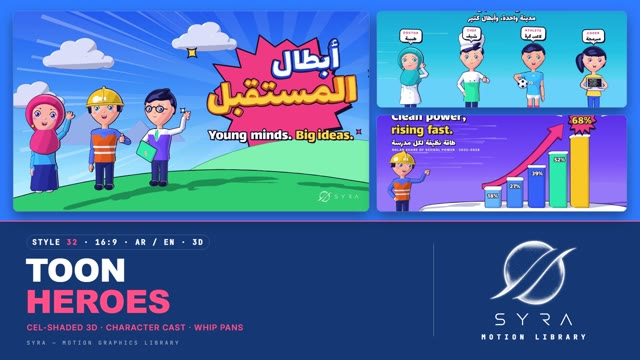

# 32 · Toon Shaded 3D

**SYRA Motion Library** · Style 32 · 16:9 · Arabic / English



<div dir="rtl">

> طريقة الاستخدام:
> انسخ البرومت ده كله وحطه لأي أداة AI أو لسكيل الـ animate، واملا الجزء الأخير ([VIDEO BRIEF]) بموضوع الفيديو.
> الستايل ده "تون ثلاثي الأبعاد" — 3D حقيقي (WebGL / three.js) بشكل مسلسلات الكرتون الحديثة: تظليل كرتوني بثلاث درجات وخطوط حبر سودا حوالين كل حاجة، شخصيات مصرية لطيفة (بنت بحجاب وبنت من غير حجاب، جد، طفل، شيف، دكتورة، لاعب كورة، مهندس، مدرّس)، انفجارات كوميك وأشعة شمس وخطوط سرعة، والانتقال المميز "Whip Pan" — الكاميرا بتلف بسرعة وخطوط سرعة بلون المشهد الجاي بتغطي الشاشة.
> مناسب للأطفال والشباب، التوعية الصحية والرياضة والأكل والمدينة والمشاريع الصغيرة والإعلانات المرحة.
> المرجع الأساسي للشكل والحركة هو ملف "source/index.html". بيشتغل بالعربي وبالإنجليزي. ممنوع اللون البني.

</div>

## Files in this folder

| File | What it is |
|---|---|
| [source/index.html](source/index.html) | The motion itself — opens and plays in a browser; the source of truth |
| [sample.mp4](sample.mp4) | Showcase reel of the style |
| The info card at the top of this file | Tags & hashtags: what the style expresses, what it suits, search words |

## Tags

<div dir="auto">

النوع: 3D حقيقي (WebGL) بتظليل كرتوني وخطوط حبر  
في سطر: 3D بشكل مسلسلات الكرتون الحديثة: شخصيات مصرية لطيفة بعيون أنمي وخطوط حبر سودا وتظليل كرتوني، على خلفيات ألوانها فاقعة بأشعة شمس وانفجارات كوميك، إحساس حماسي ومبهج زي "أبطال كل يوم".  
In one line: Real 3D styled like a modern cartoon series: cute Egyptian characters with anime eyes, thick ink outlines and cel shading, on saturated sets with sunbursts and comic bursts, energetic and cheerful "everyday heroes".  
#عربي: #كرتون #ثري_دي #أنمي #أطفال #شباب #شخصيات #توعية_صحية #رياضة #أكل #مشاريع_صغيرة #إعلان_مرح #حماسي #مبهج #ملون #كوميك #تطوع #مدينة #قصص_الأطفال  
#English: #cartoon #toon #celshaded #3d #anime #kids #youth #characters #healthawareness #sports #food #smallbusiness #funad #energetic #colourful #comic #volunteering #storytelling  
مناسب لـ: محتوى أطفال وشباب، توعية صحية ورياضة وأكل صحي، إعلانات مرحة لتطبيقات ومنتجات ومشاريع صغيرة، قصص بشخصيات (عيلة، جد وحفيد، شيف، لاعب كورة)، حملات تطوع ومبادرات، تقديم فريق أو مهن بشكل لطيف، أرقام وإنجازات بشكل احتفالي  
Best for: kids' and youth content, health, sport and healthy-food awareness, fun ads for apps, products and small businesses, character-driven stories (family, grandpa and kid, chef, footballer), volunteering campaigns, friendly team or job intros, celebratory numbers and milestones  
مش مناسب لـ: شركات رسمية وتقارير مالية جادة، طب متخصص أو مواضيع حزينة، فخامة وإعلانات راقية هادية، شرح علمي دقيق بأجزاء  
Not for: formal corporate or financial reports, specialist medicine or sad topics, calm luxury or refined ads, precise labelled science explainers  
المزاج: حماسي، ودود، متفائل، مرح، مبهج        Mood: energetic, friendly, optimistic, playful, cheerful  
الإيقاع: سريع وحماسي        Pace: fast  

</div>

## Components

| # | Component |
|---|---|
| 01 | Title Toon Letters |
| 02 | Data Bars Burst |
| 03 | Data Donut Arabic |
| 04 | Product Phone Orbit |
| 05 | Story Solar Car |
| 06 | Team Lineup |
| 07 | Chef Pan Flip |
| 08 | Grandpa And Kid |
| 09 | Three Steps Health |
| 10 | Big Number Sea |
| 11 | Timeline Small Business |
| 12 | Quote Speech Bubble |
| 13 | Before After Rooftop |
| 14 | Map Egypt Nile |
| 15 | Chapter Lower Third |
| 16 | End Logo Burst |
---

## TOON SHADED 3D — MOTION GRAPHICS STYLE PROMPT (SYRA Motion Library · Style 32 · 16:9 · Arabic / English)

### Role

You are a senior motion designer producing motion graphics in the "Toon Shaded 3D" style of the SYRA Motion Library, on ANY topic, in Arabic OR English (or both). Match the reference exactly: the source of truth is "source/index.html" (all components, playable in a browser, with a seek bar).

### 1. Style identity

- One line: a modern cel-shaded animated series rendered as real 3D — chunky toon shapes with hard 3-step shading, coloured (never grey) shadow bands, crisp rim light and thick hand-inked outlines, on saturated colour sets with comic sunbursts, impact stars, speed lines and sparkles; big toon lettering with an ink stroke and offset ink shadow.
- Mood: energetic, friendly, optimistic — "everyday heroes".
- Never: photoreal materials, grey or black shadows, soft gradients on objects, thin lines, earth tones or any brown.

### 2. Format & technical

- Canvas 1920×1080, 30 fps. One idea per scene, ~4.6 s; scenes overlap 0.6 s for the signature transition.
- Real-time 3D: three.js r160, ONE shared WebGL renderer / transparent canvas for the whole film, sandwiched between an SVG back layer (rays, bursts) and an SVG front layer (lettering, tags). MeshToonMaterial + 3-step gradient map, inverted-hull ink, one key light with shadows + ambient, no tone mapping (exact palette).
- HTML + GSAP (HyperFrames): one paused timeline; every 3D and SVG value is a pure function of time (seeded randomness, no real-time clocks), so any frame can be seeked directly. Build all geometry, faces and 3D text once.

### 3. Colour palette (use only these)

- Ink (all outlines, text strokes, shadows of type) #16122E.
- Accents: hot pink #FF4F86 (deep #E8336F) · sun yellow #FFD23F · orange #FF7A1F · mint #1FD3A0 · sky #33B6FF · blue #2F66FF · violet #7A5CFF · navy #24307A · white.
- Sets (one per scene, neighbours differ): sky #1A5CF5→#C4F1FF · violet #4A2FE8→#D7CCFF · sunshine #FFF0A8→#FFB52E · mint #0BA884→#C6FBE6 · hot pink #E8336F→#FF8FB8 · aqua #0B8FD0→#C8F3FF · tangerine #FF6A1A→#FFD27A · sea #0E3FBF→#A6E2FF · dusk #2A1F8F→#FF8FB8 · lilac #B7A2FF→#FFFFFF · cloud #C2D2FF→#FFFFFF.
- Skin rosy peach #FFC6A8 family (shade band tinted rosy, blush #FF628A); hair blue-black #1C1A44 with a blue spec band, older hair grey-white #E9EDF8. Shadows are tinted (cool violet-blue on cloth, rosy on skin), never grey.

### 4. Typography (bilingual)

- Arabic AND English display: Lalezar — as extruded 3D toon letters for titles / big numbers, or as SVG lettering with a thick ink stroke (~0.1 em) and an offset ink shadow. Small labels / kickers: Inter 800 caps, wide tracking.
- One accent word per headline (sun yellow on dark sets, pink on light sets). Latin digits. Min 28 px reading text.
- Animate whole words (squash-and-stretch pop) — never split Arabic into letters.

### 5. Drawing language (3d modelling / materials / lighting)

- Modelling: rounded boxes, lathes, tubes and blobs with chunky proportions; extruded 2D shapes (arrows, hearts, stars, pins, speech bubbles, donut slices, the map of Egypt); toon clouds; football with ink pentagons.
- Ink: inverted-hull outline with a constant 3–6 px screen width and a slight hand-inked wobble.
- Shading: 3 steps (shadow / mid / lit), tinted shadow band, crisp rim-light step, hard spec step on helmets / panels / hair.
- Characters: big heads (×1.1–1.25), canvas-drawn anime faces (gradient irises with two highlights, lid lines, blush lines, open-mouth grin), SCULPTED torsos (chest / waist / hips, flat back, rounded shoulders — never tubes), jointed arms posed with IK, 3-finger + thumb hands. Cast: girl in hijab, girl without hijab (ponytail), woman doctor in hijab, older man (grandpa), chef, footballer, engineer, teacher, kid.
- 2D layer: rotating sunburst rays, ink-outlined impact bursts, focus speed lines, horizontal streaks, sparkles, halftone dots.

### 6. Motion language (incl. camera)

- Squash-and-stretch pop-ins (back-out overshoot), letters/digits that drop piece by piece, bars that overshoot, characters that hop up into frame and land with a squash, blinks on ones, talking mouths, breathing, head bobs, waving / pointing / thumbs-up; rays turn slowly, sparkles spin, focus lines retract as the hero lands; holds never freeze.
- Camera: a purposeful move each scene (crane up, dolly back, truck along a road / steps), then a slow breath.
- Signature transition: WHIP PAN + SPEED LINES (18 frames) — the camera yaws hard with an ease-in, the frame smears horizontally, white ink-edged speed streaks fly across, dense streak bands in the NEXT scene's set colours cover the frame, a pink impact burst pops at centre for two frames, then the new camera lands from the other side with a back-out overshoot and the new hero pops in with squash-and-stretch.

### 7. Branding

- SYRA logo only — plain white on dark sets / black on light sets, never tinted, never lit, shaded or outlined.
- Corner logo: SYRA (mark + wordmark) bottom-right, ~222 px; it switches colour mid-whip while the streaks cover the frame.
- End: the stacked SYRA logo (plain black artwork) stamped onto a big white ink-outlined impact burst on the violet set, sunburst rays, tumbling toon confetti, tagline «أبطال كل يوم» / "Everyday heroes." — no corner logo.

### 8. Component library (in "toon html.html"; ar = arabic example, en = english)

- **01** 3D toon title on a pink burst, three heroes hop over the hill «أبطال المستقبل» (AR)
- **02** Toon bars + swooping arrow + 68% impact burst, engineer points "Clean power, rising fast." (EN)
- **03** 3D toon donut + footballer juggling «كيف نتحرّك كل يوم؟» (AR)
- **04** Product: toon phone (delivery app) spins in, orbiting 3D icons "Your city, one tap." (EN)
- **05** Girl in hijab lifts her solar car, teacher amazed «فكرة صغيرة، حلم كبير!» (AR)
- **06** Team: doctor, chef, footballer, coder hop onto the stage with role tags "One city, many heroes." (EN)
- **07** Chef flips the pan, veggies arc, steam and hearts «طبخة بحُب» (AR)
- **08** Grandpa and kid water a seedling that blooms "Grow it together." (EN)
- **09** Three steps on toon plinths (right-to-left) «ثلاث خطوات لصحة أفضل» (AR)
- **10** Big 3D number +12,000 splashes onto a toon sea «متطوع لشواطئ أنظف» (AR)
- **11** Timeline road: cart → kiosk → café → 3 branches "From cart to café." (EN)
- **12** Toon speech bubble quote told by grandpa «اللي يزرع… يحصد.» (AR)
- **13** Before / after rooftop with a lightning-bolt split "Same roof, new life." (EN)
- **14** Map of Egypt, Nile tube, felucca sails north, city pins «رحلة على النيل» (AR)
- **15** Chapter card «الفصل الثاني» that docks + doctor with a toon lower third (AR + EN)
- **16** End: SYRA logo on a white impact burst (AR + EN)

### 9. Sound (if the video has sfx)

- Cartoon whooshes on every whip pan (with a short "pop" on the mid-pan burst), boings and squeaky pops on landings, plucks / xylophone on text pops, a bright upbeat ukulele-and-claps bed. Duck ~18–20 dB under VO.

### 10. Do / don't

- **DO** keep thick ink on everything, coloured shadow bands, one accent word, squash on every landing, whip pans between scenes, modern Egyptian people and everyday topics (health, sport, food, city, family, the Nile and the sea).
- **DON'T** use brown/beige/tan/terracotta/wood/sepia/ochre/khaki/cream, grey shadows, realistic textures, soft fades between scenes, split Arabic into letters, or tint the SYRA logo.

## [VIDEO BRIEF] — fill this in for each new video

```text
- Language: [ Arabic / English / both ]
- Topic / title: [ ... ]
- Voiceover file or script: [ path to WAV/MP3 or the text ]
- Length: [ e.g. 45 s ]
- Headlines and the accent word in each: [ ... ]
- Numbers / steps / content: [ ... ]
- Components to use (in order): [ e.g. 01, 03, 09, 16 ]
- Characters needed: [ e.g. doctor, kid, grandpa ]
- Extra notes: [ ... ]
Output: 1920×1080, 30 fps MP4, same length as the voiceover, every visual timed to the word it illustrates,
SYRA corner logo, SYRA burst ending.
```
