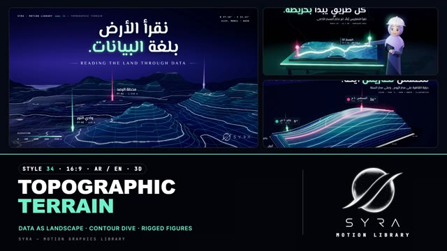

# 34 · Topographic Terrain

**SYRA Motion Library** · Style 34 · 16:9 · Arabic / English



<div dir="rtl">

> طريقة الاستخدام:
> انسخ البرومت ده كله وحطه لأي أداة AI أو لسكيل الـ animate، واملا الجزء الأخير ([VIDEO BRIEF]) بموضوع الفيديو.
> الستايل ده "التضاريس الطوبوغرافية" — 3D حقيقي (WebGL / three.js): البيانات بتتحوّل لأرض حقيقية بجبال ووديان وخطوط كنتور مضيئة، بنسختين: ليلي (كحلي غامق مع خطوط نعناعي مضيئة) وخريطة ورقية (أبيض مزرق مع خطوط حبر). فيه شخصيات 3D بأذرع متحرّكة (مهندسة، مزارع، صياد، مرشدة سياحية، أطفال)، والانتقال بين المشاهد "غطسة الكنتور" — الكاميرا بتغطس جوّه الخريطة ودواير الكنتور بتعدّي قدامها.
> مناسب للبيانات والخرائط والجغرافيا والطقس والمرور والزراعة والسياحة والنيل والبحر. بيشتغل بالعربي وبالإنجليزي. ممنوع اللون البني.
> المرجع الأساسي للشكل والحركة هو ملف "source/index.html".

</div>

## Files in this folder

| File | What it is |
|---|---|
| [source/index.html](source/index.html) | The motion itself — opens and plays in a browser; the source of truth |
| [sample.mp4](sample.mp4) | Showcase reel of the style |
| The info card at the top of this file | Tags & hashtags: what the style expresses, what it suits, search words |

## Tags

<div dir="auto">

النوع: 3D حقيقي (WebGL) — بيانات على شكل أرض وخرايط  
في سطر: البيانات بتتحول لأرض 3D بجبال ووديان وخطوط كنتور، بنسختين: ليلي كحلي بخطوط نعناعي مضيئة، وخريطة ورقية بيضا بخطوط حبر، مع دبابيس بأشعة نور وكاميرا طايرة هادية، إحساس دقيق وذكي وهادي.  
In one line: Data turned into 3D landscape with peaks, valleys and contour lines, in two looks: night navy with glowing mint contours, and a white paper map with ink lines, plus light-beam pins and slow aerial camera moves, precise, intelligent and calm.  
#عربي: #خرايط #جغرافيا #تضاريس #بيانات #كنتور #طقس #مرور #زراعة #ري_ذكي #سياحة #النيل #البحر #مساحة #طرق #مدن #ثري_دي #تقارير #تخطيط  
#English: #maps #geography #terrain #topography #contour #data #dataviz #weather #traffic #agriculture #smartirrigation #tourism #nile #sea #surveying #urbanplanning #3d #gis  
مناسب لـ: بيانات وخرايط وإحصائيات على مستوى المناطق، جغرافيا ودروس عن مصر والنيل، الطقس والمناخ، المرور والطرق والنقل، الزراعة والري الذكي والمياه، السياحة والبحر والملاحة، مشاريع مساحة وهندسة وتخطيط عمراني  
Best for: regional data, maps and statistics, geography and lessons on Egypt and the Nile, weather and climate, traffic, roads and transport, agriculture, smart irrigation and water, tourism, sea and shipping, surveying, engineering and urban-planning projects  
مش مناسب لـ: محتوى أطفال مرح، قصص عاطفية دافية، إعلانات منتجات استهلاكية سريعة، مواضيع مالهاش أي علاقة بالمكان أو الأرض أو البيانات  
Not for: playful kids' content, warm emotional stories, fast consumer-product ads, topics with no link to place, land or data  
المزاج: دقيق، هادي، ذكي، علمي، استكشافي        Mood: precise, calm, intelligent, scientific, exploratory  
الإيقاع: هادي (كاميرا جوية بطيئة)        Pace: calm  

</div>

## Components

| # | Component |
|---|---|
| 01 | Title Reading The Land |
| 02 | Data Skills Peak |
| 03 | Weather Terrain Ridgelines |
| 04 | Survey Drone Scan |
| 05 | Engineer Route Map |
| 06 | Team Terraced Model |
| 07 | Farmer Irrigation Story |
| 08 | Mentor Sea Chart |
| 09 | Three Steps Method |
| 10 | Big Number Traffic |
| 11 | Timeline Sea Routes |
| 12 | Quote Topo Model |
| 13 | Before After Survey |
| 14 | Map Egypt Nile |
| 15 | Chapter Lower Third |
| 16 | End SYRA Summit |
---

## TOPOGRAPHIC TERRAIN — MOTION GRAPHICS STYLE PROMPT (SYRA Motion Library · Style 34 · 16:9 · Arabic / English)

### Role

You are a senior motion designer producing motion graphics in the "Topographic Terrain" style of the SYRA Motion Library, on ANY topic, in Arabic OR English (or both). Match the reference exactly: the source of truth is "source/index.html" (all components, playable in a browser: click = pause, arrow keys = seek, bar = scrub).

### 1. Style identity

- One line: data shown as landscape — real 3D heightfields whose colour ramp and anti-aliased contour isolines carry the numbers; pins with light beams, lat/long grids, drifting fog sheets, slow aerial camera moves.
- Two looks in one film: NIGHT (deep indigo, glowing mint/white contours, bloom) and PAPER MAP (cool white sheet, ink contours printed into the terrain, soft shadows, laser-cut layered topo models).
- Mood: precise, calm, intelligent — "reading the land through data".
- Never: brown/earth tones, spiky noise "stalagmites", neon stripe overload, flat infographic icons.

### 2. Format & technical

- Canvas 1920×1080, 30 fps. One idea per scene, 4.6–4.9 s; scenes overlap 0.7 s for the signature transition.
- Real-time 3D: three.js r160 in ONE shared WebGL renderer / canvas (one shared light rig, one shadow map), own post chain (MSAA HDR → 2-level bloom → vignette → grain → ACES on night / no tone mapping on paper), inside HTML + GSAP (HyperFrames): one paused timeline, DOM only via fromTo / to / set, deterministic (seeded noise), every 3D value a pure function of time; all geometry built once. HTML supers follow projected 3D anchors.

### 3. Colour palette (use only these)

- Night: background #070B16, elevation ramp #10163F → #173A7A → #16808F → #3FC7A9 → #A6F2D6 → #F2FFFB, contour mint #6FF2C9, major lines #E8FFF6, accent text #9FF4DA (glow), pins rose #FF5D8F / violet #9C8CFF / mint, dusk sky #090E26 → #1A2150 with a #6A58D8 horizon glow, fog #10163A + sheets #8FA3EE.
- Paper map: background #EEF2F7 (cool white, never cream), ramp #D3DEEC → #9ED3D3 → #3FAEB0 → #1C7FA6 → #2A4F9E → #2B2878, ink #141B3C, teal #1C8FA3 (accent), rose #F0457A (Arabic accent / pins).
- People: skin rosy peach #FFB89E, hair navy-black #1C2150 or silver #DCE2F0; clothes in palette colours (lilac hijab #9C8CF5, tunic #262E6E, vest #2CD2A6, sky #4F9BFF, teal #1FB5B0, rose #F0457A, white #F2F5FA).

### 4. Typography (bilingual)

- Arabic: El Messiri 700/600 for headlines, place names, labels. English: El Messiri Latin 700 headlines (soft flared semi-serif) and wide-tracked UPPERCASE cartographic subtitles. Data: JetBrains Mono 500 (coordinates, KPIs, legends, sheet headers like "SYRA · MOTION LIBRARY — 34 · …").
- One accent word per headline (night: glowing mint; paper: teal, or rose for the Arabic line).
- Type settles in with opacity + an 18 px rise or rises word-by-word out of a mask; no CSS blur. Never split Arabic into letters. Latin digits. Reading text ≥ 28 px (mono kickers/legends excepted).

### 5. Drawing language (3d modelling / materials / lighting)

- Terrain: domain-warped fBm with a sigmoid (soft rounded massifs), low ridged detail, carved river valleys; cut terrain blocks with strata walls; round terrain tiles on pedestals; terraced (laser-cut) paper models; morphing data terrains.
- Shader: ramp albedo + AA isolines (every 4th–5th a brighter major), dense-line fade, world lat/long grid, a scan band that climbs the elevations, radial reveal, rise-from-the-survey-plane. Ink mode for paper.
- Props: pins (ground ring + pulse ring + stem + glowing head + Fresnel light beam), glowing route tubes with a travelling light pulse, instanced bars, point clouds, survey drone, ships, crops.
- People: rigged figurines — egg-shaped face with glossy eyes, catch-lights, lashes, blush; hijab as a shell that hugs the skull with an oval face opening, rolled rim and shoulder cape; hats (hard hat, cap, helmet, knit cap, Egyptian emma); beards; glasses. Arms are real shoulder > elbow > wrist rigs with two-bone IK, so hands point at and touch targets.
- Lighting: night = low lilac back-key + cool fill + hemisphere + fog; character scenes = soft front key + teal and violet rims + a warm face fill; paper = white key ≤ 2.3 total with a shadow catcher so the paper colour stays exact.

### 6. Motion language (incl. camera)

- Camera: slow aerial dolly / descent / lateral track through smooth keys, then a breathing hold. Nothing snaps.
- Data grows from the ground: terrain rises from the survey plane, bars rise staggered by distance from the peak, routes draw on, pins land (stem grows, head pops, beam rises), scan bands climb, fog drifts, terrains morph between datasets.
- People: anticipation → gesture with overshoot → settle (point via IK, wave, hold a tablet, tap, nod, look at camera), blinks and breathing in the hold.
- Signature transition — CONTOUR DIVE (0.7 s): the outgoing camera pitches down and pushes in while its contour lines flare; wobbly nested contour rings spawn at the centre and rush outward past the lens (each ring takes the old image one layer deeper); the cut ring opens onto the next scene, already at its own elevation, with fog just inside its edge. Night = glowing mint/white rings; paper = fine ink rings. HTML is clipped along the same ring.

### 7. Branding

- SYRA logo only — plain white on night scenes, plain black on paper scenes, never tinted, never lit.
- Corner logo: SYRA (mark + wordmark) bottom-right, 222 px; it switches colour as the transition ring passes the corner.
- End: SYRA stacked logo alone (plain white) over a summit whose pin beam rises toward it, tagline «نقرأ الأرض… ونرسم الغد.» / "READ THE LAND · MAP WHAT'S NEXT".

### 8. Component library (in "terrain html.html"; ar = arabic example, en = english)

- **01** Night title: terrain rises, pins land «نقرأ الأرض بلغة البيانات.» (AR)
- **02** Paper data hero: 308 bar-districts + call-outs A/B/C + KPIs "Where skills peak." (EN)
- **03** Weather terrain: temperature hour × month with 12 ridgelines «للطقس تضاريس أيضًا.» (AR)
- **04** LiDAR survey drone scanning a paper terrain tile "Mapped from above." (EN)
- **05** Survey engineer (hijab, hard hat) points at a glowing route «كل طريقٍ يبدأ بخريطة.» (AR)
- **06** Four people rise onto a terraced model: farmer, rider, forecaster, fisher "One map, many journeys." (EN)
- **07** Farmer taps his tablet, water flows into the field «كل قطرة في مكانها.» (AR)
- **08** Grandfather fisherman teaches his granddaughter a sea chart "Reading the sea, together." (EN)
- **09** Three steps on pedestals (RTL): point cloud → contours → route «ثلاث خطوات لقرار أذكى.» (AR)
- **10** Big number −35% over a morphing city-traffic terrain «وقتٌ أقل في الزحام.» (AR)
- **11** Sea-route timeline 2020–2026 with year beacons and a ship "Charting the sea, year by year." (EN)
- **12** Quote over a laser-cut topo model «مَن يعرف أرضه، يعرف طريقه.» (AR)
- **13** Before / after: a survey wall turns guesswork into contoured ground truth + flood zones (EN)
- **14** Egypt relief map: the Nile flows south → north, delta, city pins «النيل يرسم خريطة مصر.» (AR)
- **15** Chapter card «الفصل الثالث: السياحة» + lower third, tour guide waving (AR + EN)
- **16** End: SYRA logo over the summit beam (AR + EN)

### 9. Sound (if the video has sfx)

- Airy synth pads and soft sub swells, sonar-like pings on pin landings, a rising whoosh with layered "ring" ticks on the Contour Dive, light data blips on counters, wind/water textures. Duck ~18–20 dB under VO.

### 10. Do / don't

- **DO** keep contours readable (majors ~25–60 px apart), let data grow from the ground, one accent word, pins land with beams, characters gesture with real arm rigs, alternate night and paper scenes.
- **DON'T** use brown/beige/tan/ochre/sepia/cream/wood (not in soil, skin, hair or shadows), spiky terrain, milky over-bloom, generic cross-fades, frozen holds, text over busy terrain without contrast, a tinted logo.

## [VIDEO BRIEF] — fill this in for each new video

```text
- Language: [ Arabic / English / both ]
- Topic / title: [ ... ]
- Voiceover file or script: [ path to WAV/MP3 or the text ]
- Length: [ e.g. 45 s ]
- Headlines and the accent word in each: [ ... ]
- Numbers / places / steps / content: [ ... ]
- Components to use (in order): [ e.g. 01, 03, 14, 16 ]
- Night or paper for each scene: [ ... ]
- Characters needed: [ ... ]
- Extra notes: [ ... ]
Output: 1920×1080, 30 fps MP4, same length as the voiceover, every visual timed to the word it illustrates,
SYRA corner logo, SYRA summit ending.
```
