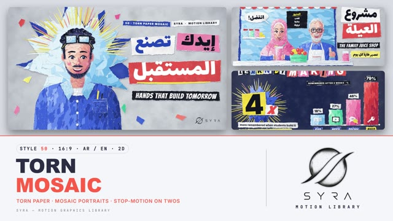

# 50 · Torn Paper Mosaic

**SYRA Motion Library** · Style 50 · 16:9 · Arabic / English



<div dir="rtl">

> طريقة الاستخدام:
> انسخ البرومت ده كله وحطه لأي أداة AI أو لسكيل الـ animate، واملا الجزء الأخير ([VIDEO BRIEF]) بموضوع الفيديو.
> الستايل ده "موزاييك الورق المقطّع" — 2D على كانفاس: كل حاجة معمولة من ورق ملوّن متقطّع بالإيد، حافته بيضا وفيها ألياف، وعليه ظل ناعم، والوشوش والهدوم معمولة من قصاصات صغيرة بتعمل الإضاءة والظل. العناوين قصاصات كلمات (والإنجليزي على طريقة حروف الجرايد). الحركة "على اتنين" زي الستوب موشن: القطع بتنزل وتستقر واحدة واحدة.
> مناسب للقصص الإنسانية، المبادرات المجتمعية، المشاريع الصغيرة، الصحة والأكل، المدينة والبحر والنيل، والتعليم بالإيد.
> المرجع الأساسي للشكل والحركة هو ملف "source/index.html". بيشتغل بالعربي وبالإنجليزي. ممنوع اللون البني والبيج والكرافت/الكرتون.

</div>

## Files in this folder

| File | What it is |
|---|---|
| [source/index.html](source/index.html) | The motion itself — opens and plays in a browser; the source of truth |
| [sample.mp4](sample.mp4) | Showcase reel of the style |
| The info card at the top of this file | Tags & hashtags: what the style expresses, what it suits, search words |

## Tags

<div dir="auto">

النوع: 2D (كانفاس، ورق مقطّع بحركة ستوب موشن)  
في سطر: كولاج دافي معمول من ورق ملوّن متقطّع بالإيد بحواف بيضا، الوشوش والهدوم من قصاصات صغيرة، والقطع بتنزل واحدة واحدة على اتنين.  
In one line: A warm hand-made collage of torn coloured paper with white fibrous edges — mosaic faces and clothes, pieces landing one by one on twos.  
#عربي: #ورق_مقطع #كولاج #موزاييك #ستوب_موشن #شغل_يدوي #قصص_إنسانية #مشاريع_صغيرة #مبادرات_مجتمعية #صحة_وأكل #بيانات #إنفوجرافيك #شخصيات #مصر #النيل #البحر #تعليم_بالإيد #عربي_وإنجليزي #ملون  
#English: #tornpaper #papercollage #mosaic #stopmotion #handmade #craft #humanstories #smallbusiness #community #healthyfood #infographic #dataviz #characters #egypt #nile #bilingual #colourful #2d  
مناسب لـ: قصص ناس حقيقية ومجتمع، المشاريع الصغيرة والمحلات، الصحة والأكل الصحي، الرياضة والشباب، المدينة والبحر والنيل، التعليم بالإيد والورش، المبادرات والحملات الإنسانية، فيديوهات سوشيال دافية  
Best for: real-people and community stories, small businesses and shops, health and healthy eating, sport and youth, city / sea / Nile topics, hands-on learning and workshops, social campaigns, warm social-media explainers  
مش مناسب لـ: مواضيع رسمية جدًا أو مؤسسية باردة، تكنولوجيا مستقبلية لامعة، مواضيع حزينة أو حساسة، بيانات كتير ودقيقة جدًا  
Not for: very formal or cold corporate topics, glossy futuristic tech, sad or sensitive subjects, dense precise data dashboards  
المزاج: دافي، إنساني، مبهج، معمول بالإيد        Mood: warm, human, cheerful, handcrafted  
الإيقاع: متوسط (حركة على اتنين، تجميع سريع ووقفة بتتنفس)        Pace: medium  

</div>

## Components

| # | Component |
|---|---|
| 01 | Title Maker Hands |
| 02 | Data Learn By Making |
| 03 | Data Plate Pie |
| 04 | Product Bakery App Tap |
| 05 | Character Family Juice Shop |
| 06 | Team Four Cards |
| 07 | Story Alexandria Fisherman |
| 08 | Mentor Coach Footballer |
| 09 | Three Steps Business |
| 10 | Big Number Nile |
| 11 | Timeline Rider Day |
| 12 | Quote Proverb Farmer |
| 13 | Before After Rooftop |
| 14 | Map Egypt Sun Sea Nile |
| 15 | Chapter Lower Third Artist |
| 16 | End SYRA Lockup |
---

## TORN PAPER MOSAIC — MOTION GRAPHICS STYLE PROMPT (SYRA Motion Library · Style 50 · 16:9 · Arabic / English)

### Role

You are a senior motion designer producing motion graphics in the "Torn Paper Mosaic" style of the SYRA Motion Library, on ANY topic, in Arabic OR English (or both). Match the reference exactly: the source of truth is "source/index.html" (all components, playable in a browser).

### 1. Style identity

- One line: a hand-made collage of torn coloured paper on a cool grey or deep navy board. Every piece has a torn edge with a white fibrous core, loose paper fibres, a soft cool-navy drop shadow and paper grain. Portraits, clothes, skies and charts are mosaics of small torn shards whose flat tones model light and shade; headlines are word scraps.
- Mood: warm, human, crafted: "made by hand, piece by piece".
- Never: smooth vector fills, gradients standing in for paper, kraft or cardboard boards, brown or warm-grey shadows.

### 2. Format & technical

- Canvas 1920×1080, 30 fps, motion stepped on twos (15 fps). One idea per scene, 4.5–4.7 s; scenes overlap 0.9 s for the signature transition.
- ONE 2D canvas for the whole film inside HTML + GSAP (HyperFrames): one paused timeline driving a master proxy, every frame a pure function of timeline time (seeded randomness, no rAF / Date / Math.random). Each scene is built once into paper PIECES (cropped sprites: every scrap, sliver, mosaic base sheet and shard batch) in illustrator order; a frame only places pieces. Direct seek to any time shows the right frame. Fully built by ~2 s, then hold with life.

### 3. Colour palette (use only these)

- Boards: cool grey #D9DDE3 (light scenes) · deep navy #17224A (dark scenes) + grain, mottle, cool vignette.
- Cobalt #93B5FF #5F89F6 #3962E2 #2747B8 #1B3388 · sky #E6F6FF #C2E7FF #97D3FA #6BBAEE #4A9BD8
- Coral-red #FFB4A6 #FF8372 #F4554A #D93C3D #B42B3C · pink #FFE2EC #FFB9D2 #FF90B8 #F2679C #D14A80
- Lemon #FFFAC8 #FFF27A #FFE53E #F9D21A #F0BE0C · mint #DFFCEF #AAF2D4 #70E1BA #3BC89C #21A27F
- White paper #FFFFFF #F3F6FA #E4EAF2 #CBD4E1 #AEB9CC · ink / black paper #121521
- Skin (rosy peach, shadows rose / plum): A #FFE0D0 #FDC7B0 #F7AE98 #EC948A #DA7882 #BC5F79 · B (deeper) #F9CDB5 #EFAF97 #E2958A #CF7C80 #B4637A #934E6C · hair navy-black #3B4994 … #0A0D1D · white hair #F4F6FA … #66728E.
- Shadows are always rgba(14,22,52,·). The white core and fibres stay pure white.

### 4. Typography (bilingual)

- Arabic: Lalezar, every word on its own torn scrap (whole words, never split into letters; 18–22 px vertical padding for the tall marks). English display: Bangers on scraps and black tapes; ransom titles mix Bangers and Inter Black letter by letter. Inter 800/900 for kickers ("SYRA · MOTION LIBRARY"), values, digits and small captions.
- One accent word per headline on a strong scrap (coral, cobalt, mint, lemon). Latin digits in both languages. Min 28 px.

### 5. Drawing language

- Tear: outlines resampled every ~2 px and pushed by fractal noise (low bite + fine jag); a second, wider outline makes the white core, with 0.7 px white fibres where it is wide; colour paper on top, overprinted with grain and mottle.
- Mosaic regions: a base sheet in the mid tone, then a jittered grid of 4–6-sided torn shards (elongated along a flow angle) quantised to 4–6 flat tones from a light function (upper-left light, local shadows). Slivers (thin tapered strips) for brows, lids, lashes, beards, hair streaks, rays, net lines, underlines.
- Faces: hand-placed feature scraps (almond eye, iris, catchlight, dark lid sliver, nose scraps, open smile with teeth, blush shards). At small scale the shards get bigger and the dither drops so faces stay readable.
- People: modern Egyptians — women with and without hijab, men young and older, kids, elders; doctor, engineer, developer, chef, fisherman, coach, footballer, delivery rider, farmer, mural artist, shop owners.
- Hands: dedicated piece set — pointing hand, open hand, thumbs-up, mitten hands holding things — always on a sleeve.

### 6. Motion language (incl. camera)

- Everything on twos. Pieces LAND: each starts 30–45 px up-right, scaled up to 1.3 and turned ~0.2 rad, then settles with a back-ease in ~0.25 s; shard batches drop in; word scraps land last; underlines and arrows are torn on with a wipe.
- Data: bars rise in 26 px stacked strips with the value scrap riding the top and counting; pie wedges sweep in as torn sheets; big numbers flick through digits on twos then settle; a scooter rides a timeline tape; a BEFORE sheet is peeled off to reveal AFTER.
- Holds breathe: slow camera push (2–3.5 %), halo rays and confetti wobble, 2-frame blinks, waving / tapping / dabbing hands, a fish that wiggles, boats bobbing, gulls flapping.
- Signature transition — PAPER FLUTTER, THEN SCRAP-BY-SCRAP ASSEMBLE (0.9 s overlap): the outgoing pieces tremble, then lift one by one in reverse build order (titles first, background last) — scale up, shadow grows — and blow away along a seeded wind with a little fall and turn; a fresh board sheet with a torn white-cored edge is laid from the right when the board colour changes; the next scene assembles piece by piece in illustrator order (bursts and panels, base sheets, shards, features, then words).

### 7. Branding

- SYRA logo only — plain white on the navy board, plain black on the grey board, never tinted, never torn or textured.
- Corner logo: SYRA (mark + wordmark) bottom-right ~222×60 px (58 px right, 50 px bottom); keep that corner free of paper.
- End: the SYRA stacked logo alone, plain black artwork on a white torn paper card that assembles from big shards over a cobalt burst with halo slivers and confetti; tagline «كل قطعة بتفرق» / "EVERY PIECE COUNTS". No corner logo there.

### 8. Component library (in "mosaic html.html"; ar = arabic example, en = english)

- **01** Title + maker portrait in a halo «إيدك تصنع المستقبل» (AR)
- **02** Ransom title + torn bars + 4× "LEARN BY MAKING" (EN)
- **03** Plate pie chart with food scraps «نص الطبق خضار» (AR)
- **04** Bakery app + pointing hand taps ORDER "ONE TAP. OPEN FOR BUSINESS" (EN)
- **05** Family juice shop, granddaughter + grandfather «مشروع العيلة» (AR)
- **06** Team of four on colour cards "ONE TEAM" (EN)
- **07** Alexandria fisherman in a porthole «رزق البحر» (AR)
- **08** Coach (open hand) + young footballer "EVERY DAY, A LITTLE BETTER" (EN)
- **09** Three steps, right-to-left «ابدأ مشروعك» (AR)
- **10** Big number 6,650 KM + Nile ribbon «كيلومتر من النيل» (AR)
- **11** Timeline of a delivery rider's day "A RIDER'S DAY" (EN)
- **12** Proverb quote + farmer woman «اللي يزرع يحصد» (AR)
- **13** Before / after rooftop garden, peel reveal "ROOFTOP GARDEN" (EN)
- **14** Map of Egypt with pins «شمس وبحر ونيل» (AR)
- **15** Chapter 02 + lower third, mural artist «الفن في الشارع» (AR+EN)
- **16** End SYRA card (AR + EN)

### 9. Sound (if the video has sfx)

- Paper: soft taps and rustles on each landing (randomised, slightly stepped), a quick paper-flutter whoosh on transitions, a tear on reveals and underlines; light pizzicato / marimba / hand percussion bed. Duck ~18–20 dB under VO.

### 10. Do / don't

- **DO** tear every edge (white core + fibres), keep shadows cool navy, land pieces on twos, keep faces readable, one accent word, vary people and topics, keep the bottom-right logo corner clear.
- **DON'T** use brown / beige / tan / kraft / cardboard / terracotta / wood / sepia / ochre / cream, smooth vector shapes, glides or morphs, typed-on text, split Arabic letters, floating hands, or frozen holds.

## [VIDEO BRIEF] — fill this in for each new video

```text
- Language: [ Arabic / English / both ]
- Topic / title: [ ... ]
- Voiceover file or script: [ path to WAV/MP3 or the text ]
- Length: [ e.g. 45 s ]
- Headlines and the accent word in each: [ ... ]
- Numbers / steps / content: [ ... ]
- Components to use (in order): [ e.g. 01, 05, 09, 16 ]
- Characters needed: [ ... ]
- Extra notes: [ ... ]
Output: 1920×1080, 30 fps MP4, same length as the voiceover, every visual timed to the word it illustrates, motion on twos,
SYRA corner logo, SYRA paper-card ending.
```
