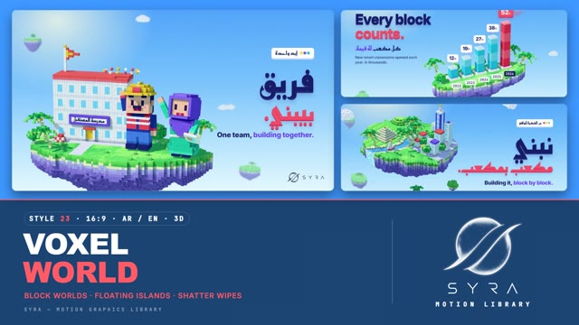

# 23 · Voxel World

**SYRA Motion Library** · Style 23 · 16:9 · Arabic / English



<div dir="rtl">

> طريقة الاستخدام:
> انسخ البرومت ده كله وحطه لأي أداة AI أو لسكيل الـ animate، واملا الجزء الأخير ([VIDEO BRIEF]) بموضوع الفيديو.
> الستايل ده "مكعب بمكعب" — 3D حقيقي (WebGL / three.js): جزر طايرة منورة في سما زرقا، كل حاجة فيها مبنية من مكعبات صغيرة، العالم بيتبني من تحت لفوق والعناوين بتتختم مربع مربع، وشخصيات مكعبات بتشتغل وتلوّح، وبين المشاهد العالم بيتفك لمكعباته — مناسب للتعليم، البناء، المدن، والأطفال.
> المرجع الأساسي للشكل والحركة هو ملف "source/index.html". بيشتغل بالعربي وبالإنجليزي. ممنوع اللون البني.

</div>

## Files in this folder

| File | What it is |
|---|---|
| [source/index.html](source/index.html) | The motion itself — opens and plays in a browser; the source of truth |
| [sample.mp4](sample.mp4) | Showcase reel of the style |
| The info card at the top of this file | Tags & hashtags: what the style expresses, what it suits, search words |

## Tags

<div dir="auto">

النوع: 3D حقيقي (WebGL / three.js — عالم مبني من مكعبات صغيرة)  
في سطر: جزر طايرة منورة في سما زرقا، كل حاجة فيها مكعبات (عشب، نخل، مدارس، النيل، أبراج بيانات) بتتبني من تحت لفوق، وشخصيات مكعبات بتشتغل وتلوّح — مبهج وبنّاء ومتفائل.  
In one line: Bright floating islands in a blue sky where everything is built from small cubes (grass, palms, schools, the Nile, data towers) assembling bottom-up, with blocky characters working and waving; cheerful, constructive, optimistic.  
#عربي: #فوكسل #مكعبات #3D #ماينكرافت #بناء #تعليم #مدارس #أطفال #مدن #مبادرات #بنية_تحتية #مبهج #متفائل #لعّيب #إنفوجرافيك #برمجة #تعليم_مدرسي #زراعة  
#English: #voxel #cubes #blocks #3d #minecraftstyle #building #construction #education #school #kids #city #infrastructure #cheerful #optimistic #playful #infographic #coding #stem  
مناسب لـ: بناء مدارس ومشروعات ومدن (حاجة "بتتبني")، تعليم وبرمجة وSTEM للأطفال والشباب، مبادرات قومية وتنمية بأرقام، زراعة وتشجير وبيئة بشكل مرح، فرق عمل وتعاون، خريطة مصر وتوسّع في المحافظات، تايم لاين وخطوات بطريقة لعّيبة  
Best for: building schools/projects/cities (things "being built"), education, coding and STEM for kids and youth, national initiatives and development figures, playful farming/greening/environment, teamwork, Egypt map and regional expansion, playful timelines and steps  
مش مناسب لـ: شركات فخمة رسمية أو بنوك (استخدم Liquid Chrome)، محتوى عاطفي حزين أو جاد، شرح هندسي دقيق، مواضيع طبية حساسة  
Not for: formal luxury corporate or banking (use Liquid Chrome), sad or serious emotional content, precise engineering explainers, sensitive medical topics  
المزاج: مبهج، بنّاء، متفائل، لعّيب، نشيط        Mood: cheerful, constructive, optimistic, playful, lively  
الإيقاع: متوسط        Pace: medium  

</div>

## Components

| # | Component |
|---|---|
| 01 | Title Nile Island |
| 02 | Every Block Counts |
| 03 | KPI Ring |
| 04 | Idea Lightbulb |
| 05 | Team Builds School |
| 06 | Team Of Four |
| 07 | Child Plants Tree |
| 08 | Mentor And Student |
| 09 | Three Steps |
| 10 | Big Number |
| 11 | Timeline Road |
| 12 | Quote Plaque |
| 13 | Before After |
| 14 | Map Of Egypt |
| 15 | Chapter Lower Third |
| 16 | End Logos |
---

## VOXEL WORLD — MOTION GRAPHICS STYLE PROMPT (SYRA Motion Library · Style 23 · 16:9 · Arabic / English)

### Role

You are a senior motion designer producing motion graphics in the "Voxel World" style of the SYRA Motion Library, on ANY topic, in Arabic OR English (or both). Match the reference exactly: the source of truth is "source/index.html" (all components, playable in a browser).

### 1. Style identity

- One line: bright floating voxel islands in a blue sky, built in real 3D from bevelled cubes with baked AO — grass tops, periwinkle-to-violet strata underneath, palms, trees, white towns, the Nile — lit by one sun with soft shadows, a sky-dome fill and a lilac bounce; far islands and clouds sit in a blurred layer for depth.
- Mood: cheerful, constructive, optimistic — "building the future, block by block".
- Never: sand-coloured or khaki ground, mixed complementary colours (coral + green = brown), giant characters.

### 2. Format & technical

- Canvas 1920×1080, 30 fps. One idea per scene, 4.6–5.0 s; scenes overlap 1.0 s for the signature transition.
- Real-time 3D: three.js r160 in ONE shared WebGL renderer / canvas for the whole film, inside HTML + GSAP (HyperFrames): one paused timeline, DOM only via fromTo / to / set, deterministic (seeded randomness / hash), every 3D value a pure function of timeline time; models built once with interior culling. No CSS keyframes, no remote assets. ~15k visible voxels and one voxel size per scene. Full state by ~2.8 s, then a breathing hold.

### 3. Colour palette (use only these)

- Grass #68CF62 · #93DE6C · #4FBD5B, leaves #34B25A · #23994E · #7EE07A — water / Nile #3CCFE6 · #19B2EA, foam #E9FBFF
- Sand pale lemon only #F1F4C4 · #F7F9DC · #E6EEAE — island underside #BEC8FA · #ABAFF4 · #9C94EB · #8F82E3
- Whites #F7FAFF · #E4ECFA, road #DCE3F6, glass #5CC8F2 — ink #16206B — skin #FFCBAA (shade #F9B798, cheeks #FFAAB4)
- Accents: coral #FF5A66 · yellow #FFD23F · violet #7B61FF (type #6A4DFF) · teal #22BFA5 · sky #56B7FF
- Skies: day, day2, dawn (lilac → pink), night (navy → indigo with twinkling stars).

### 4. Typography (bilingual)

- Arabic display + UI: Reem Kufi 700. English: Inter 800 (−0.035em), 600 for small descriptions. Every headline line has a stacked navy extrusion; the ONE accent word / line is coral with a coral extrusion. Arabic right at 118 px, English left at 120 px.
- Kicker chips with three coloured cubes; JetBrains Mono 500 for mono kickers and year chips; white value-tag bubbles and mono chips pinned to 3D points; sub lines with a violet phrase. Headlines stamp in block by block.
- Latin digits in both languages. Min 28 px for reading text. Never split Arabic into letters.

### 5. Drawing language (3d modelling / materials / lighting)

- Modelling: everything is bevelled cubes — floating islands with layered strata, grass tops, rocks, palms (lime-painted trunks), round trees, cloud puffs, white buildings with glass, solar roofs and spires, data towers (lighter band every 5 blocks), plaques, a voxel road, bridges, a pale-lemon pyramid, a voxelised Egypt outline, 5×7 voxel digits.
- Materials: matte, satin, glass / screen, water, skin, cloud and emissive (lit windows, lamps); baked AO on every cube.
- Lighting: one sun with a soft 2048 shadow, sky-dome PMREM fill, lilac hemisphere bounce, light fog; blurred far layer.
- People: blocky rigged characters ~25 voxels tall (children ~18) — woman in hijab with a tablet, engineer, young man in a violet hoodie, elder with white beard, glasses and teal cardigan, schoolchild / girl in hijab with a backpack.

### 6. Motion language (incl. camera)

- Block by block: worlds assemble bottom-up, towers grow layer by layer, roads and bridges are laid plank by plank, digits rain in glyph by glyph and land with a squash; headlines and labels stamp in cell by cell with a small overshoot.
- Characters wave, walk, carry, lob blocks, hop, nod and cheer; heads track the object in play; faces stay ~25° to camera.
- Camera: keyframed orbit with lens shift — crane up from a low angle, truck or push in, then a slow drift and bob.
- Signature transition: Voxel Shatter → Reassemble — the old world detaches in a wave from the next scene's hero point, cubes pop, tumble and fall while its type breaks into square cells; a rain of loose sky cubes tints toward the new palette, the sky cross-fades, and the next world assembles bottom-up block by block.

### 7. Branding

- SYRA logo only — plain white on dark scenes / black on light scenes, never tinted (never a lit / shaded 3D surface: a DOM image or an unlit plane).
- Corner logo: SYRA (mark + wordmark) bottom-right ~222 px — black on the day / dawn skies, white on night scenes.
- End: SYRA lockup alone (plain black, stamped cell by cell onto a white card on ONE big voxel plaque that builds bottom-up on a floating island), loose cubes orbiting above, tagline «نبني المستقبل، مكعب بمكعب.» / "Building the future, block by block.".

### 8. Component library (in "voxel html.html"; ar = arabic example, en = english)

- **01** Floating Nile island title «نبني مكعب بمكعب.» (AR)
- **02** Five data towers "Every block counts." (EN)
- **03** Voxel KPI ring 62% «فصولنا بقت أذكى.» (AR)
- **04** Lightbulb assembles and lights up "Ideas that light up." (EN)
- **05** Team builds the school «فريق بيبني.» (AR)
- **06** Four stack a tower together "Better together." (EN)
- **07** Girl plants a tree that grows «نزرع بكرة.» (AR)
- **08** Mentor & student, a book changes hands "Learn it. Pass it on." (EN)
- **09** Three islands + stair bridges «خطوة بخطوة.» (AR)
- **10** Big number 50K in voxel digits «طالب وطالبة بيبرمجوا.» (AR)
- **11** Voxel road timeline "The road ahead." (EN)
- **12** Quote plaque «لا ننتظر المستقبل، نصنعه.» (AR)
- **13** Bare rock blooms green "From rock to life." (EN)
- **14** Voxel map of Egypt, the Nile flows north «في كل ربوع مصر.» (AR)
- **15** Chapter 02 + lower third (AR+EN)
- **16** End: SYRA voxel plaque (AR + EN)

### 9. Sound (if the video has sfx)

- Crisp block clicks and stacking ticks, bouncy pops on stamps, a crumbling cascade on the shatter, an upbeat plucky bed. Duck ~18–20 dB under VO.

### 10. Do / don't

- **DO** build everything from cubes, assemble bottom-up, one sun with soft shadows + AO, keep the world built before the stamp, one coral word.
- **DON'T** use brown/beige/tan/terracotta/wood/sepia/ochre/khaki/olive (check AO corners on pale sand), mixed complementary colours, or split Arabic.

## [VIDEO BRIEF] — fill this in for each new video

```text
- Language: [ Arabic / English / both ]
- Topic / title: [ ... ]
- Voiceover file or script: [ path to WAV/MP3 or the text ]
- Length: [ e.g. 45 s ]
- Headlines and the accent word in each: [ ... ]
- Numbers / steps / content: [ ... ]
- Components to use (in order): [ e.g. 01, 05, 09, 16 ]
- Characters needed: [ ... ]
- Extra notes: [ ... ]
Output: 1920×1080, 30 fps MP4, same length as the voiceover, every visual timed to the word it illustrates,
SYRA corner logo, SYRA lockup ending.
```
