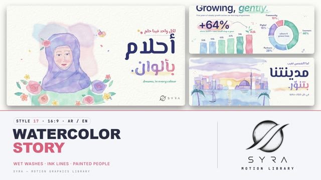

# 17 · Watercolor Story

**SYRA Motion Library** · Style 17 · 16:9 · Arabic / English



<div dir="rtl">

> طريقة الاستخدام:
> انسخ البرومت ده كله وحطه لأي أداة AI أو لسكيل الـ animate، واملا الجزء الأخير ([VIDEO BRIEF]) بموضوع الفيديو.
> الستايل ده "ألوان مائية" — رسم مائي حقيقي على ورق أبيض، غسلات شفافة بتفتح وتسيح في بعض، خط حبر رفيع، وكلمة واحدة متلوّنة — مناسب للحكايات، المجتمع والعيلة، التعليم، والمحتوى الإنساني الهادي.
> المرجع الأساسي للشكل والحركة هو ملف "source/index.html". بيشتغل بالعربي وبالإنجليزي. ممنوع اللون البني.

</div>

## Files in this folder

| File | What it is |
|---|---|
| [source/index.html](source/index.html) | The motion itself — opens and plays in a browser; the source of truth |
| [sample.mp4](sample.mp4) | Showcase reel of the style |
| The info card at the top of this file | Tags & hashtags: what the style expresses, what it suits, search words |

## Tags

<div dir="auto">

النوع: 2D (رسم ألوان مائية على ورق أبيض + خط حبر رفيع)  
في سطر: رسم مائي حقيقي بغسلات شفافة بتفتح وتسيح في بعض بألوان باستيل (بينك، موف، نعناعي، سماوي، ليموني) وخط حبر رفيع — دافي وحنين وإنساني.  
In one line: Genuine watercolour on white paper — soft transparent pastel washes that bloom and bleed (rose, violet, mint, sky, lemon) with fine ink lines; warm, gentle and human.  
#عربي: #ألوان_مائية #رسم_يدوي #حكاية #قصص_الأطفال #عيلة #مجتمع #أمومة #تعليم #إنساني #دافي #هادي #باستيل #ورق #مشاعر #تنمية #خيري #توعية  
#English: #watercolor #watercolour #handpainted #storytelling #kidsstory #family #community #motherhood #education #human #warm #gentle #pastel #paper #emotional #charity #ngo #awareness  
مناسب لـ: حكايات وقصص أطفال، فيديوهات العيلة والأم والمجتمع، تعليم ابتدائي وقراءة، جمعيات خيرية وتنمية ومبادرات إنسانية، توعية مجتمعية بلطف، تقارير أثر (Impact) هادية، مناسبات ورسائل تهنئة دافية  
Best for: storytelling and children's stories, family/mothers/community films, primary education and reading, charities/development/humanitarian initiatives, gentle social awareness, calm impact reports, warm greetings and occasions  
مش مناسب لـ: تقنية وهاي تك ومستقبل، إعلانات حماسية سريعة أو رياضة أو ألعاب، بيانات كتير معقدة ودقيقة، براندات فخمة لامعة  
Not for: high-tech or futuristic content, fast hype ads, sports or gaming, dense precise data, glossy luxury brands  
المزاج: دافي، حنين، إنساني، هادي، حالم        Mood: warm, tender, human, calm, dreamy  
الإيقاع: هادي        Pace: calm  

</div>

## Components

| # | Component |
|---|---|
| 01 | Title Nile Sunrise |
| 02 | Data Growing Gently |
| 03 | Garden Of Growth |
| 04 | Journey Map |
| 05 | Dreamer In Violet Hijab |
| 06 | Kite On The Hill |
| 07 | Family Under The Sun |
| 08 | Teacher Reading Letters Birds |
| 09 | Stepping Stones |
| 10 | Sky Numbers Balloons |
| 11 | Four Seasons Timeline |
| 12 | Quote Card Sow And Reap |
| 13 | Before After Rainbow |
| 14 | City At Dusk Lights |
| 15 | Chapter Lower Third |
| 16 | End Logos Garland |
---

## WATERCOLOR STORY — MOTION GRAPHICS STYLE PROMPT (SYRA Motion Library · Style 17 · 16:9 · Arabic / English)

### Role

You are a senior motion designer producing motion graphics in the "Watercolor Story" style of the SYRA Motion Library, on ANY topic, in Arabic OR English (or both). Match the reference exactly: the source of truth is "source/index.html" (all components, playable in a browser).

### 1. Style identity

- One line: genuine watercolour illustration on clean cool-white cold-press paper — wet-on-wet blooms, pigment pooled in darker rims, soft bleeds, transparent layered washes, white paper reserved for highlights, fine slightly wobbly indigo ink line work on top, and ONE accent word painted as if in colour.
- Mood: warm, gentle, human — "painting the future, together".
- Never: cream/beige/sepia paper, muddy warm-over-cool mixes, flat fills, generic fades as the main move.

### 2. Format & technical

- Canvas 1920×1080, 30 fps. One idea per scene, 4.2–4.8 s; scenes overlap 1.0 s for the signature transition.
- HTML + GSAP (HyperFrames): one paused timeline, only fromTo / to / set, deterministic (seeded randomness), no CSS keyframes, no remote assets, no mix-blend-mode. Hold the full state for the last ~1 s of every scene before the transition.

### 3. Colour palette (use only these)

- Paper #FBFBF8 (cool white) with a grain overlay · ink / headlines indigo #2C3570
- Warm: rose #F08CA0 · coral #F4A28C (stays pinkish) · lemon #F7D774
- Cool: mint #8ED1B8 · sky #8EC5EA · ultramarine #4A6FD1 · violet #9A86D8 · teal #3FA7A0
- Text-safe: rose #D9607A · teal #2B8C86 · violet #7C68C4 · body #535A8A. Washes at opacity 0.2–0.8. Warm over warm, cool over cool only; reserve white paper under a warm object on a cool wash.

### 4. Typography (bilingual)

- Arabic display: El Messiri 700. English: Inter 600 (−0.035em). Headlines in indigo ink, ONE painted accent word that fills like a wash (violet→rose→coral→lemon, teal, violet or sun pigment).
- Handwritten notes and chart labels: Marhey. Kickers: Inter 600 caps with tracking.
- Latin digits in both languages. Min 28 px for reading text. Never split Arabic into letters.

### 5. Drawing language

- Vignettes with ragged edges and paper around them: Nile sunrises with a reserved sun, palms, reeds, birds, boats, five-petal flowers, peonies, leaves, splashes; painted bars and donuts with handwritten labels.
- People painted from washes (violet hijab over a mint dress, pale coral/rose skin glaze with violet shadows, soft cheek blooms) and a few fine ink lines for closed eyes, brows, nose and lips.

### 6. Motion language

- The painter's hand: washes bloom from where the brush touches (wet and dark, then settle with the rim last); colours bleed into neighbours; ink lines draw on; palms rise and unfurl, flowers blossom petal by petal; the accent word fills like a wash, notes write themselves; petals, birds and boats drift; slow push 1.03 → 1.
- Signature transition: washWipe — graded flat wash bands are brushed across the frame right → left, the scenes swap under full cover, then the wash lifts out from the centre.

### 7. Branding

- SYRA logo only — plain white on dark scenes / black on light scenes, never tinted (this style is paper, so black).
- Corner logo: SYRA (mark + wordmark) bottom-right ~222 px, plain black on the paper.
- End: SYRA lockup alone (mark above wordmark, flat black) framed by a flower garland + the tagline «نرسم المستقبل، معًا.» / "Painting the future, together.".

### 8. Component library (in "watercolor html.html"; ar = arabic example, en = english)

- **01** Nile sunrise title (AR)
- **02** Painted bars + donut (EN)
- **03** Garden of growth (AR)
- **04** Journey map of Egypt (EN)
- **05** Dreamer in a violet hijab (AR)
- **06** Child flying a kite (EN)
- **07** Family under the sun (AR)
- **08** Teacher reading to a child (EN) 09 Stepping stones (AR)
- **10** Numbers on hot-air balloons (AR)
- **11** One tree, four seasons (EN)
- **12** Quote card «اللي بيزرع… بيحصد.» (AR)
- **13** Before / after the rain (EN)
- **14** City at dusk (AR)
- **15** Chapter page + painted lower third (AR+EN)
- **16** End SYRA lockup + garland (AR + EN)

### 9. Sound (if the video has sfx)

- Soft brush strokes and water drops, paper rustle, birdsong, a gentle piano / strings bed. Duck ~18–20 dB under VO.

### 10. Do / don't

- **DO** let washes bloom and bleed, keep white paper for highlights, fine sparse ink, one painted word.
- **DON'T** use brown/sepia/ochre/beige/cream/olive tones, stack warm over cool (it turns to mud), or use flat opaque fills.

## [VIDEO BRIEF] — fill this in for each new video

```text
- Language: [ Arabic / English / both ]
- Topic / title: [ ... ]
- Voiceover file or script: [ path to WAV/MP3 or the text ]
- Length: [ e.g. 45 s ]
- Headlines and the accent word in each: [ ... ]
- Numbers / steps / content: [ ... ]
- Components to use (in order): [ e.g. 01, 05, 09, 16 ]
- Characters needed: [ ... ]
- Extra notes: [ ... ]
Output: 1920×1080, 30 fps MP4, same length as the voiceover, every visual timed to the word it illustrates,
SYRA corner logo, SYRA logo ending.
```
